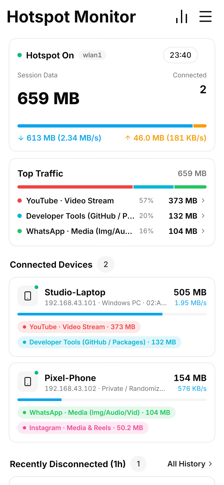
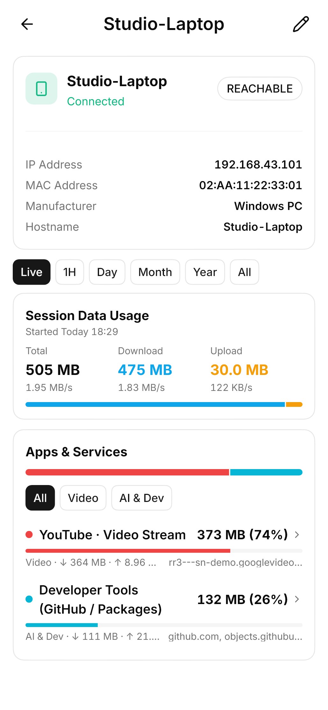
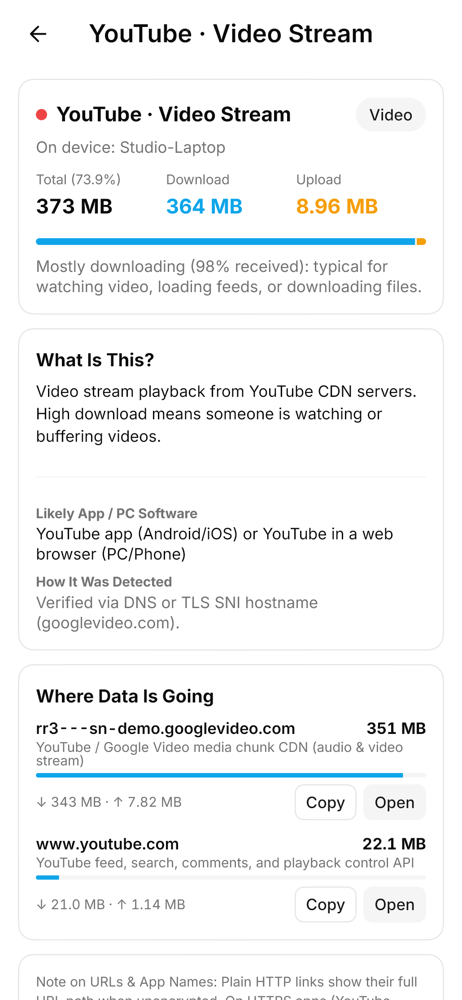
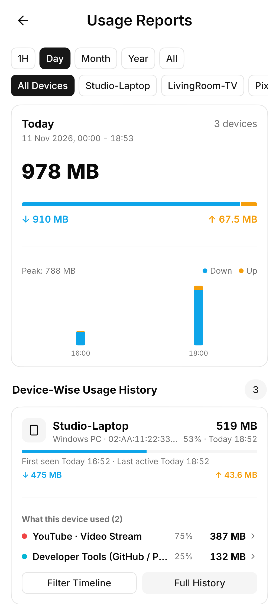

<div align="center">

<br />


<h1>Hotspot Monitor</h1>

<p>
  <strong>Real-time Android hotspot device, speed, domain, and usage history monitor by <a href="https://techyke.in">AP Labs</a>.</strong>
</p>

<p>
  <a href="https://github.com/justakhi/hotspot-monitor/actions/workflows/ci-and-release.yml">
    
  </a>
  <a href="https://github.com/justakhi/hotspot-monitor/releases/latest">
    
  </a>
  
  <a href="LICENSE">
    
  </a>
</p>

<p>
  <a href="#screenshots">Screenshots</a> &nbsp;&bull;&nbsp;
  <a href="#download-and-install">Download APK</a> &nbsp;&bull;&nbsp;
  <a href="#features">Features</a> &nbsp;&bull;&nbsp;
  <a href="#non-root-vs-root-mode">Non-Root vs. Root</a> &nbsp;&bull;&nbsp;
  <a href="#read-only-safety-and-privacy">Safety</a> &nbsp;&bull;&nbsp;
  <a href="#build-from-source">Build</a>
</p>

<br />

</div>

---

## Screenshots

<p align="center">
  All screenshots below use sanitized demo hostnames, local IPs, and sample MAC addresses.
</p>

<table>
  <tr>
    <td align="center" width="25%">
      <br /><br />
      <strong>Home Dashboard</strong><br />
      <sub>Live connected count, session speeds, top traffic, and 1h disconnect list.</sub>
    </td>
    <td align="center" width="25%">
      <br /><br />
      <strong>Device Detail</strong><br />
      <sub>Device identity, live/historical ranges, and per-app category breakdown.</sub>
    </td>
    <td align="center" width="25%">
      <br /><br />
      <strong>Service &amp; Domain Info</strong><br />
      <sub>Plain-English explanation, detection method, and resolved host endpoints.</sub>
    </td>
    <td align="center" width="25%">
      <br /><br />
      <strong>Usage Reports</strong><br />
      <sub>Hourly, daily, monthly, and yearly timelines saved in local SQLite.</sub>
    </td>
  </tr>
</table>

<br />

---

## Features

<table>
  <tr>
    <td valign="top" width="50%">
      <h3>Live Client &amp; History Tracking</h3>
      <ul>
        <li><strong>True Connected Count:</strong> Home shows only devices currently online, checked via neighbor states and ARP reachability.</li>
        <li><strong>Recently Disconnected (1h):</strong> Clients that left in the last hour appear in their own Home card with disconnect time and saved byte totals.</li>
        <li><strong>Connection History:</strong> Dedicated screen listing every past device with first-seen and last-seen timestamps.</li>
        <li><strong>Device Identification:</strong> Combines DHCP leases, <code>dumpsys network_stack</code>, mDNS, IEEE OUI vendor lookup, OS hints, randomized MAC flags, and custom user aliases.</li>
      </ul>
    </td>
    <td valign="top" width="50%">
      <h3>Passive DPI &amp; Service Attribution</h3>
      <ul>
        <li><strong>Native C Packet Probe (<code>libhs_probe.so</code>):</strong> Inspects metadata over <code>AF_PACKET</code> using <code>hs_probe.c</code> and <code>quic_sni.c</code>.</li>
        <li><strong>Multi-Packet TLS &amp; QUIC SNI:</strong> Extracts domains from split post-quantum TCP <code>ClientHello</code> frames and QUIC Initial <code>CRYPTO</code> packets (UDP 443, 4443, 8443).</li>
        <li><strong>DNS &amp; HTTP Host Inspection:</strong> Parses UDP/TCP DNS responses (port 53), plain HTTP Host/path headers (port 80), and app-private learned hosts (<code>learned_hosts_v1.tsv</code>).</li>
        <li><strong>Plain-English Service View:</strong> Groups traffic into clear services (YouTube, WhatsApp, Instagram, Telegram, Netflix, GitHub, etc.) with endpoint details.</li>
      </ul>
    </td>
  </tr>
</table>

<h3>Persistent SQLite Reports</h3>
<ul>
  <li>Tracks per-device and per-service download/upload bytes locally in SQLite across <strong>1H</strong>, <strong>Day</strong>, <strong>Month</strong>, <strong>Year</strong>, and <strong>All</strong> windows with exact calendar timestamps.</li>
  <li>Supports per-device timeline filtering and reset/clear controls inside <strong>Menu &amp; Settings</strong>.</li>
</ul>

<br />

---

## Non-Root vs. Root Mode

Hotspot Monitor starts in **Non-Root Mode** automatically if root is unavailable or denied, and unlocks full per-device telemetry automatically when `su` is granted (Magisk, KernelSU, APatch).

| Capability | Non-Root Mode | Root Mode (`su`) |
| --- | :---: | :---: |
| Hotspot interface, gateway IP, and session timer | Included | Included |
| Total hotspot download/upload bytes (`NetworkStatsManager`) | Included (with Usage Access) | Included |
| Active subnet scan &amp; mDNS device names | Best-effort | Included |
| Real-time connected vs. disconnected check (`ip neigh` / ARP) | Basic | Included |
| DHCP hostname, OUI manufacturer, OS hint, randomized MAC badge | Partial | Included |
| Per-device download/upload bytes &amp; live speed (`B/s`) | Not available | Included |
| Per-device service &amp; domain breakdown (DNS, TLS SNI, QUIC SNI) | Not available | Included |
| Saved SQLite reports &amp; Connection History | Session totals | Full per-device &amp; service |

<br />

---

## Download and Install

1. Open the <a href="https://github.com/justakhi/hotspot-monitor/releases/latest"><strong>GitHub Releases</strong></a> page.
2. Download `HotspotMonitor-arm64-v8a.apk` (recommended for modern Android phones) or `HotspotMonitor-universal.apk`.
3. Install the APK on your device.
4. Open **Hotspot Monitor**:
   - Grant **Usage Access** in `Menu & Settings` when prompted for non-root tethered byte counts.
   - If your phone is rooted, approve the superuser prompt on launch to activate read-only per-device monitoring and passive SNI/DNS inspection.

<br />

---

## Read-Only Safety and Privacy

- **Zero system changes:** Even with root access, Hotspot Monitor never modifies `/system`, `/vendor`, `iptables` or `nftables` rules, certificates, or Android framework settings.
- **100% offline storage:** No telemetry SDKs, analytics trackers, or remote servers. All history, device aliases, and learned `IP -> domain` caches remain inside private app storage.
- **Client encryption stays intact:** Full HTTPS URLs (such as exact video IDs) and encrypted payloads stay private between connected devices and the servers they visit.

<br />

---

## Educational and Acceptable Use Disclaimer

Hotspot Monitor is intended strictly for **learning, personal network diagnostics, and monitoring your own mobile hotspot** or networks you have explicit authorization to administer. You are responsible for complying with applicable local laws and obtaining consent from users on your network where required. **AP Labs and the author (`@justakhi`) are not responsible for any misuse, unauthorized monitoring, or damages resulting from use of this software.**

<br />

---

## Project Structure

```text
lib/
  domain/models/        # CapabilityState, HotspotSnapshot, ConnectedDevice, ServiceUsage, HistoryReport
  data/services/        # Platform channel bridge, SQLite history store, SharedPreferences aliases
  data/repositories/    # Delta accounting merging native telemetry with persistent history
  ui/core/              # Forui theme, formatters, service explainers, shared widgets
  ui/features/          # Dashboard, Device Detail, Service Detail, Reports, Connection History, Settings
android/app/src/main/
  cpp/                  # hs_probe.c & quic_sni.c compiled into libhs_probe.so
  kotlin/.../           # CapabilityChecker, NonRootTelemetrySource, RootTelemetrySource, ServiceClassifier
  res/                  # Custom adaptive launcher icon & multi-density mipmap assets
.github/workflows/
  ci-and-release.yml    # Automated Flutter checks, split/universal APK builds, and GitHub Releases
```

<br />

---

## Build from Source

Requirements:
- Flutter SDK (`3.47.x` stable)
- Android SDK (`compileSdk 36`, NDK `28.2.13676358`, CMake `3.22.1`) and JDK 17

```powershell
flutter pub get
flutter analyze
flutter test
flutter build apk --release
```

### Automated GitHub Releases
- Every push or pull request to `main` runs `flutter analyze`, `flutter test`, and uploads release APK artifacts.
- Pushing a version tag (`v*`, such as `v1.0.0`) or running the **CI & Release Build** workflow manually with a `release_tag` input publishes a GitHub Release with `HotspotMonitor-universal.apk`, `HotspotMonitor-arm64-v8a.apk`, `HotspotMonitor-armeabi-v7a.apk`, and `SHA256SUMS.txt`.
- Optional release signing secrets in GitHub repository settings: `ANDROID_KEYSTORE_BASE64`, `ANDROID_KEYSTORE_PASSWORD`, `ANDROID_KEY_ALIAS`, `ANDROID_KEY_PASSWORD`.

<br />

---

## Credits &amp; Contact

<div align="center">

Built by **AP Labs** &bull; **Akshay Kumar** (`@justakhi`)

<p>
  <a href="https://techyke.in">
    
  </a>
  <a href="https://github.com/justakhi">
    
  </a>
  <a href="https://t.me/God_Asura">
    
  </a>
  <a href="mailto:contact@techyke.in">
    
  </a>
</p>

</div>

---

## Copyright &amp; License

Copyright &copy; 2026 **AP Labs - Akshay Kumar (`@justakhi`)**. All rights reserved.

Licensed under the **PolyForm Noncommercial License 1.0.0** ([LICENSE](LICENSE)) and [NOTICE](NOTICE):
- **Free for personal use:** Anyone may download, install, inspect, and build Hotspot Monitor for free for personal, educational, or non-commercial use.
- **No selling or commercial theft:** Selling this app, publishing paid or ad-monetized clones, or using the codebase for commercial gain without separate written permission from AP Labs (`contact@techyke.in`) is strictly prohibited.
- **Attribution required:** Keep all copyright notices, `LICENSE`, `NOTICE`, and AP Labs attribution intact.
